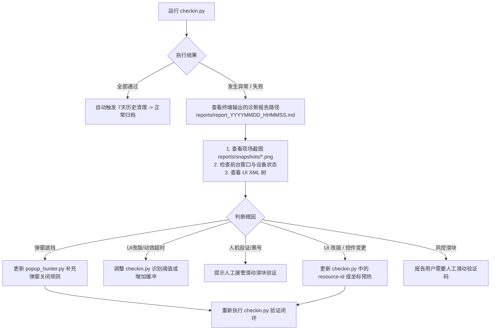

# miyoushe-checkin (米游社签到与自愈系统)

> **基于 Python + ADB + 本地轻量视觉像素判别的 Android 全自动签到系统**  
> 专为米游社三款核心游戏（《原神》、《崩坏：星穹铁道》、《绝区零》）每日签到打造。

---

## 设计理念：极速规则引擎 + 智能自愈

自动化在现实场景中通常面临两大矛盾：
* **纯脚本方案**：速度快，但遇到活动全屏弹窗、版本更新公告、节假日顶栏改版、或手机休眠锁屏时容易异常中断。
* **纯大模型交互方案**：虽然具备视觉理解力，但每一步都需要截图和网络推理，耗时长达数分钟，日常使用效率低下。

**本项目采用了“极速规则主导 + 智能自愈”的双模架构**：
1. **日常运行（高速通道）**：由纯 Python 驱动，利用坐标预热和动态自适应重试，**12~20 秒内完成全部 3 款游戏签到**；
2. **异常接管（自愈通道）**：一旦遇到未知弹窗、布局变更或风控拦截，系统自动冻结现场（保存截图、UI 树 XML 与软硬件状态），并生成规范的诊断报告。配合 AI 编程助手（如 Antigravity、Claude Code、Cursor 等）使用时，可直接读取故障切片并快速热修复规则。

---

## 运行载体与设备连接要求

本项目通过 **ADB (Android Debug Bridge)** 与安卓系统底层通信，支持以下任何一种运行载体：

| 设备类型 | 支持情况 | 典型代表 / 连接方式 |
| :--- | :---: | :--- |
| **物理真机** | 原生支持 | 小米、Vivo、OPPO、华为等各类安卓手机。开启【开发者选项】与【USB 调试】后连接。 |
| **安卓模拟器** | 推荐挂机 | MuMu 模拟器 12、雷电模拟器、夜神模拟器等。开启模拟器自带的 ADB 调试端口即可。 |
| **云端 / 虚拟机** | 服务器挂机 | Redroid (Docker 安卓)、Waydroid (Linux 原生安卓)、云手机、AVD。 |

> **连接验证**：  
> 确保在宿主机终端执行 `adb devices` 时，设备状态显示为 `device`：
> ```bash
> $ adb devices
> List of devices attached
> emulator-5554    device  # 或物理手机序列号 / 无线调试 IP:端口
> ```

---

## 自动化管理优势

米游社客户端具备以下典型特征：
1. **频繁的运营弹窗**：版本前瞻、新角色活动时常出现全屏遮罩；
2. **客户端静默更新**：弹出“发现新版本”模态提示框；
3. **顶栏与金刚区排序调整**：新活动可能导致快捷图标位置漂移；
4. **安全风控拦截**：异地或频繁请求可能触发人机滑块验证。

**系统内置针对性处理**：
* 出现异常时自动采集保留 `reports/snapshots/*.png` 现场截图与设备上下文；
* 配合 AI 助手可直接定位分析是控件类名变更、坐标漂移还是网络延迟，并快速调整规则，无需人工复杂排查。

---

## 模块架构与各文件职责详解

项目遵循高内聚模块化设计：

```text
miyoushe-checkin/
├── .gitignore          # 忽略 Python 缓存、虚拟环境与动态生成的 reports 目录
├── README.md           # 系统技术文档与运维指引
├── requirements.txt    # 锁定第三方核心依赖 (pillow, numpy)
├── checkin.py          # 核心流程编排引擎 (主入口)
├── adb_client.py       # ADB 底层通信与 UIAutomator 控件树交互层
├── popup_hunter.py     # 弹窗猎手 (自动检测与关闭各类弹窗)
└── reporter.py         # 诊断报告生成器 (现场冻结、根因研判、自动清理)
```

### 1. [checkin.py](checkin.py)（核心调度引擎）
* **自动自举虚拟环境**：脚本启动时检测当前解释器是否在 `.venv` 中，若否，则自动无缝透明切换到 `.venv` 执行，跨平台兼容 Windows / macOS / Linux。
* **设备与状态自检**：检测休眠自动亮屏（`keyevent 224`），穿透系统锁屏（`wm dismiss-keyguard`），并确保米游社（`com.mihoyo.hyperion`）真正处于前台活跃焦点。
* **首页坐标预热缓存 (`build_home_cache`)**：启动时仅 Dump 一次 UI 树，预热并缓存原神、星铁、绝区零三个频道的点击坐标。
* **全月多天网格自适应定位 (`get_card_pos`)**：基于屏幕宽度 `W` 等比换算卡片网格坐标，按月度日历自动计算当天待签卡片位置，杜绝不同长宽比手机错位。
* **页面加载缓冲与核验 (`wait_for_checkin_ready`)**：通过画质方差与多重轮询过滤骨架屏未渲染状态，避免未就绪时抢跑退出。

### 2. [adb_client.py](adb_client.py)（驱动交互层）
* 封装原生 ADB 命令调用、屏幕分辨率获取（`wm size`）。
* 提供手势抽象：中心点击、比例点击（`tap_ratio`）、滑动手势（`swipe`）、物理按键模拟（`keyevent`）。
* 解析 Android `uiautomator dump` XML 树，支持根据 `resource-id` 和 `text` 动态提取控件矩形范围与中心点击点。

### 3. [popup_hunter.py](popup_hunter.py)（弹窗猎手）
* 专职负责“破障”：识别由于活动全屏图、版本更新、青少年模式、协议同意等遮挡主界面导致的卡顿。
* 包含三级破障策略：
  1. 关键词文本按钮命中（如 `["跳过", "关闭", "我知道了", "暂不更新", "取消"]`）；
  2. 弹窗通用控件 ID 命中（如 `close_btn`, `iv_close`, `cancel` 等）；
  3. 尝试安全后退（`KEYCODE_BACK`）。

### 4. [reporter.py](reporter.py)（诊断报告器）
* **现场冻结与取证**：故障发生瞬间，自动采集当前设备电量、亮屏状态、前台 Activity、截屏快照与 UI 树 XML，归档至 `reports/snapshots/`。
* **根因智能研判**：
  - `DEVICE_LOCKED_OR_ASLEEP`：设备锁屏或休眠导致未进入前台；
  - `APP_NOT_IN_FOREGROUND`：被短信、微信或桌面切出前台；
  - `SECURITY_VERIFICATION`：触发了滑块安全风控拦截；
  - `POPUP_OVERLAY`：检测到全屏弹窗遮挡；
  - `NORMAL` / `UI_DUMP_FAILED`：选择器漂移或动效超时。
* **自动过期清理 (`cleanup_old_reports`)**：若签到完全正常，自动静默清除 7 天前的历史报告与大图切片，永不无上限占用磁盘。

---

## 视觉判别技术细节

米游社每日签到页面属于 WebView 渲染，卡片内部无法通过 Android 原生控件树获取文本。因此系统采用**毫秒级本地视觉像素特征过滤 (PIL + NumPy)**：

| 游戏频道 | 状态判定机制 | 像素判别逻辑 |
| :--- | :--- | :--- |
| **原神** | 已签卡片盖有**绿色对勾**徽章 | 过滤高饱和绿色像素：`(G > 120) & (G > R + 20) & (G > B + 40) > 400` |
| **崩坏：星穹铁道** | 已签卡片盖有**“已领取”橙黄印章** | 过滤暖橙色印章像素：`(R > 190) & (110 < G < 185) & (B < 80) > 400` |
| **绝区零** | 待签卡片有**亮橙高亮与叹号**，已签呈**暗色遮罩置灰** | 待签：`(R > 165) & (G > 80) & (B < 90) & (R - B > 50) > 1500`；已签：橙色像素 < 200 且平均灰度 < 125 |

---

## 快速上手

### 1. 安装 ADB 与依赖
确保宿主机已安装 Python 3.8+ 及 ADB 工具：

- **Windows**：
  ```powershell
  winget install Google.PlatformTools
  # 或直接下载官方 Platform-Tools 解压并添加到系统环境变量 PATH
  ```
- **macOS**：
  ```bash
  brew install android-platform-tools
  ```
- **Ubuntu / Debian**：
  ```bash
  sudo apt update && sudo apt install -y adb
  ```

安装 Python 核心依赖：
```bash
pip install -r requirements.txt
```

### 2. 连接安卓设备 / 模拟器
1. 手机打开【设置】->【系统/更多设置】->【开发者选项】-> 开启【USB 调试】（部分机型需同时开启【USB 调试（安全设置）】以允许模拟触控）。
2. 使用数据线连接电脑，在手机弹出的授权窗口点击【始终允许】。
3. 验证连接：
   ```bash
   adb devices
   # 终端显示设备序列号与 device 状态即代表就绪
   ```

### 3. 执行自动化签到
```bash
python3 checkin.py
```

### 4. 可选测试参数
* **强制模拟未签到点击**（即使今日已签，也真实触发卡片触控与后验）：
  ```bash
  python3 checkin.py --force-click
  ```

---

## 排障与自愈流程



1. **直接读取 Markdown 诊断报告**：路径通常为 `reports/report_<时间戳>.md`；
2. **调阅事故切片**：重点查看 `reports/snapshots/*.png` 图像，确认当前停留在哪个页面；
3. **定位热修**：直接在 `checkin.py` 或 `popup_hunter.py` 中更新选择器或手势坐标，然后重新触发测试。
